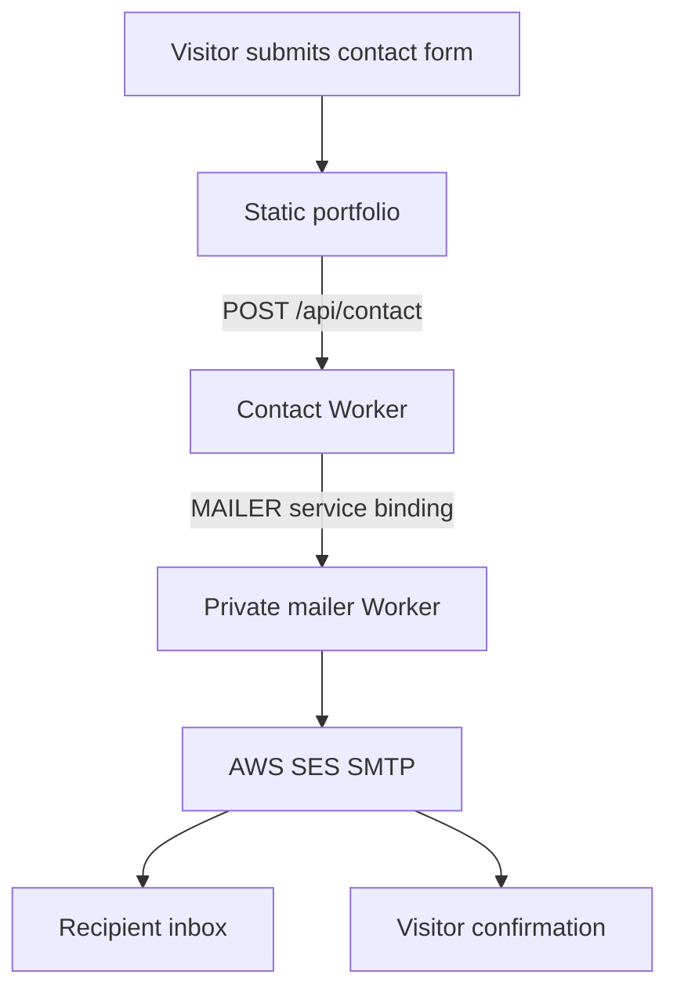

# Production deployment guide

This repository is the source for the public portfolio at **https://portfolio.jelvan.pro**.

## Production target

| Setting | Value |
|---|---|
| GitHub repository | `DevJel/Jelvan-R-Portfolio` |
| Production branch | `main` |
| Hosting | Cloudflare Pages |
| Cloudflare account | `Jelvan - Projects - Works` |
| Pages project | `jelvan-r-portfolio` |
| Pages output | `out/` |
| Build command | `npx next build` (equivalent to `npm run build`) |
| Framework | Next.js 14 static export |
| Custom domain | `portfolio.jelvan.pro` |
| Pages fallback domain | `jelvan-r-portfolio.pages.dev` |

The app uses Next.js static export (`output: 'export'` in `next.config.mjs`). A successful build writes the static site to `out/`. Cloudflare Pages serves those files. Do **not** use `wrangler deploy` to publish the website: that command deploys the separate contact API Worker described below.

## Deployment flow

1. Commit and push changes to `main`.
2. GitHub Actions runs the quality gate: brand check, dependency install, unit/tool tests, Next.js production build, browser checks, export assertions and Wrangler dry runs.
3. Cloudflare Pages Git integration watches the same repository and deploys the `out/` directory from `main`.
4. Verify the latest Pages production deployment references the pushed commit and reaches the `deploy: success` stage.
5. Open the custom domain and test the key routes and contact flow.

Cloudflare Pages project source must reference the current GitHub owner `DevJel`, repository `Jelvan-R-Portfolio`, and production branch `main`. If the repository is transferred or renamed, update the Pages Git source connection before relying on automatic deployments.

## Local validation

Requirements: Node.js 20 LTS (minimum supported by the project is Node.js 18.18).

```bash
npm ci
npm run test:tools
npm run build
npm run test:tools:browser
```

The browser test requires Playwright Chromium:

```bash
npx playwright install --with-deps chromium
npm run test:tools:browser
```

Confirm that `out/index.html`, `out/404.html`, the portfolio routes, SEO files, security.txt, headers, and expected assets exist before publishing.

## Cloudflare Pages configuration

- Project: `jelvan-r-portfolio`
- Production branch: `main`
- Build command: `npm run build`
- Build output directory: `out`
- Root directory: repository root
- Framework preset: Next.js (static export)
- Custom domain: `portfolio.jelvan.pro`

Keep the Pages Git integration as the single production deploy trigger. Avoid enabling a second simultaneous deploy path from GitHub Actions unless the Pages Git integration is intentionally disabled; duplicate deploy pipelines can race and make the deployed commit ambiguous.

## Contact form architecture

The contact form is a static page backed by a separate Cloudflare Worker and a private mail relay:



- Contact Worker configuration: `wrangler.jsonc`
- Private mail relay configuration: `wrangler.mailer.jsonc`
- Contact Worker route: `portfolio.jelvan.pro/api/contact*`
- Worker service binding: `MAILER` → `jelvan-portfolio-mailer`
- Recipient: `hello@work.jelvan.pro`
- SES credentials must remain in Cloudflare secret bindings; never commit credential values.
- The contact form is not an SMS or OTP service.

Deploy the private mail relay before the contact Worker when changing its code or bindings:

```bash
npm run deploy:mailer
npm run deploy
```

These commands deploy only the mail relay and contact API Worker. They do not publish the static portfolio.

## Post-deployment smoke test

- [ ] Homepage loads at `https://portfolio.jelvan.pro/`.
- [ ] About, Projects, Contact and Resume routes load directly.
- [ ] All seven project detail routes load and their dashboard artwork is present.
- [ ] Repository explorer links and file previews behave as documented.
- [ ] Developer tools and SVG Library load; search, filters, copy and download actions work.
- [ ] Mobile navigation and carousel controls work at phone widths.
- [ ] Contact form validates input, shows a success state only after server confirmation, and plays its confirmation sound only after success.
- [ ] Contact Worker responds at `/api/contact`; recipient and visitor confirmation emails are received.
- [ ] Unknown routes show the exported 404 page.
- [ ] Canonical URL, sitemap, robots.txt, security.txt, metadata and social previews are correct.

## Rollback

Use Cloudflare Pages → `jelvan-r-portfolio` → Deployments to inspect production history and roll back to the last known-good deployment. Revert the offending Git commit as well so the source branch and deployed artifact return to the same known-good state.

## Security and operational rules

- Never place API tokens, SMTP credentials, private keys, or secret values in source files, documentation, screenshots, or client-side bundles.
- Do not expose private repositories or internal source folders through the public repository explorer.
- Treat repository previews as public content; redact secrets and organization-specific data before adding sample files.
- Keep a clear distinction between illustrative dashboard artwork and real production screenshots or live data.
- Verify the exact commit, deployment status, custom domain and contact service after every release.
