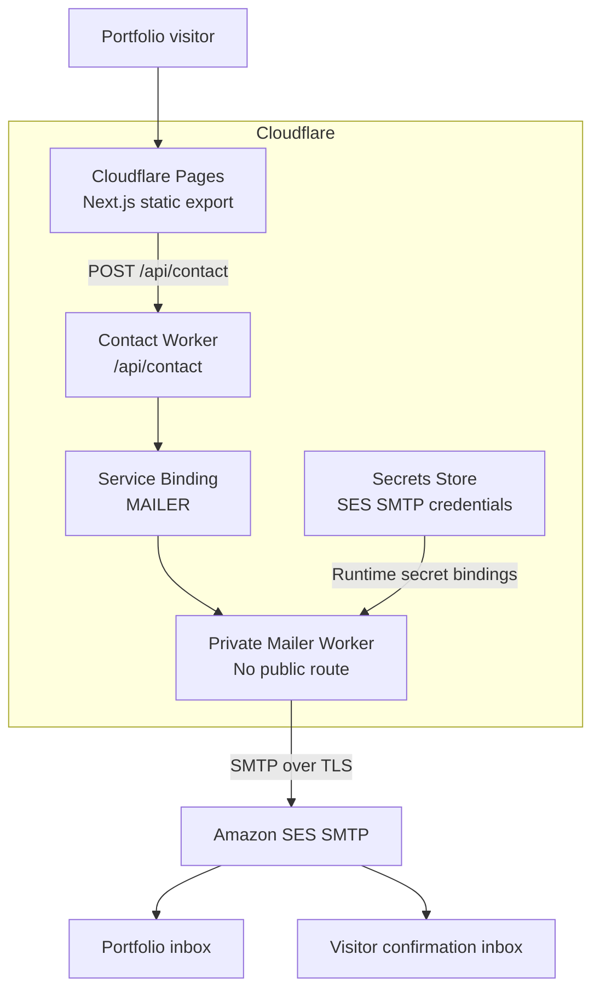
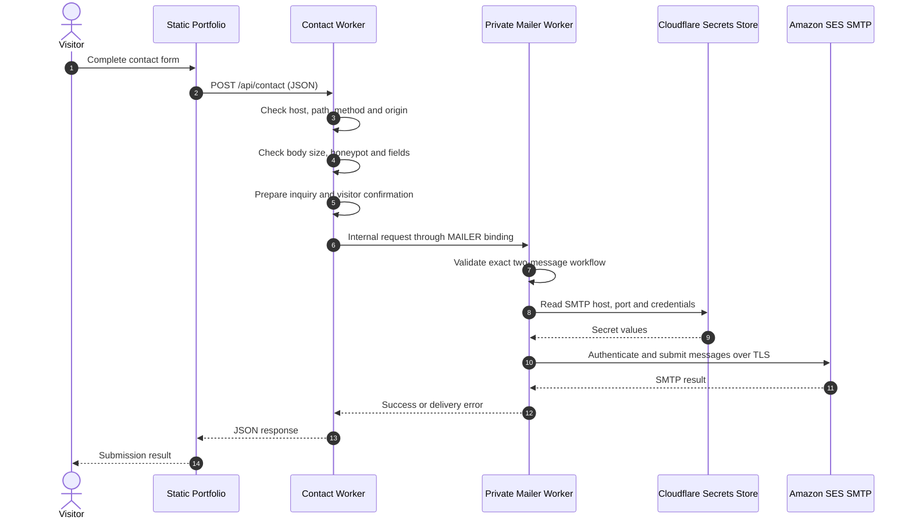
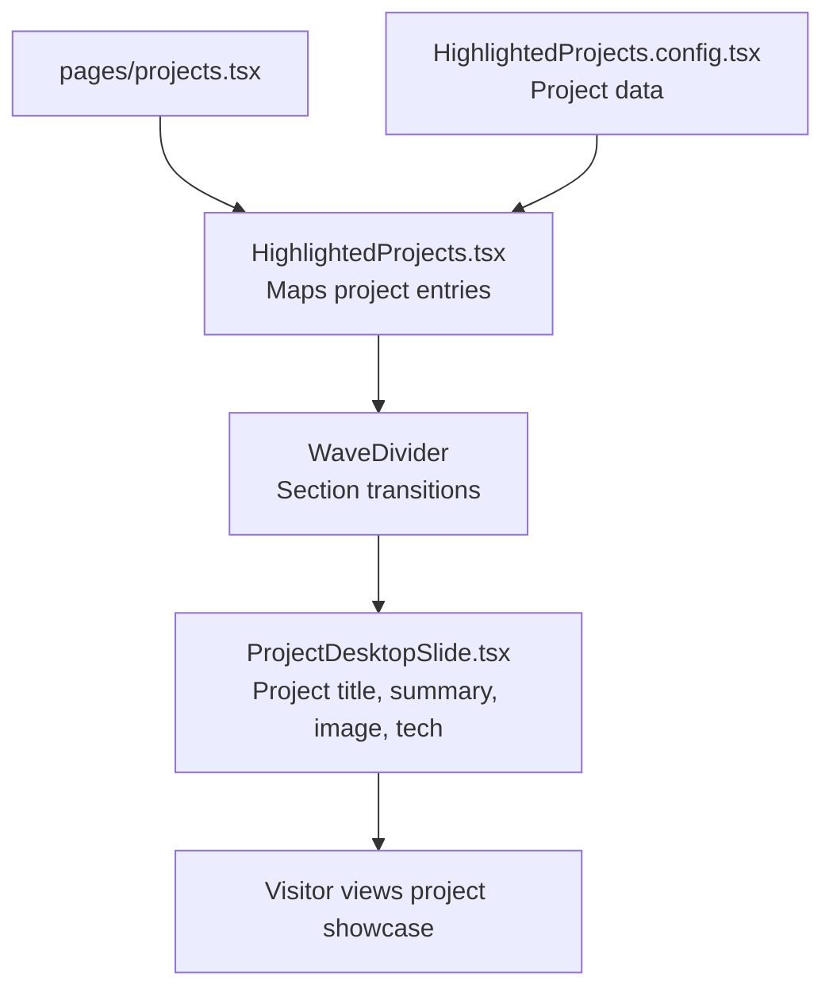
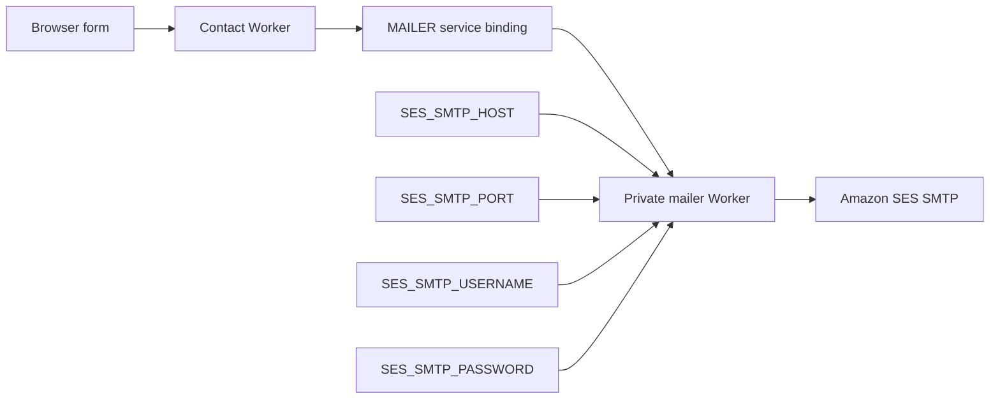
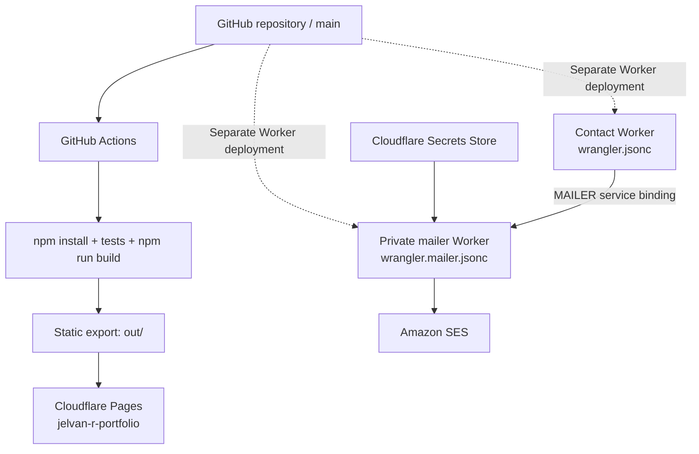

# Jelvan® — Dual-View Personal Portfolio

**Live website:** [https://portfolio.jelvan.pro](https://portfolio.jelvan.pro)  
**Repository:** [DevJel/Jelvan-R-Portfolio](https://github.com/DevJel/Jelvan-R-Portfolio)<br />
**Owner:** Jelvan B. Ricolcol  
**Primary branch:** `main`  
**License:** Proprietary — all rights reserved

An interactive, desktop-inspired portfolio built with Next.js, React, TypeScript, and Styled Components. Its central professional goal is to help organizations achieve practical digital transformation by connecting people, processes, data and technology. The portfolio emphasizes end-to-end Human Resources transformation — from workforce planning and recruitment through onboarding, employee development and offboarding — alongside enterprise systems for finance, procurement, customer service, IT operations, knowledge, communications, analytics and automation.

> **Documentation scope:** This README describes the portfolio application and the infrastructure declared in this repository. It does not imply that every showcased project is deployed as part of this portfolio, or that every external service has been independently health-checked.

---

## Contents

1. [Purpose and experience](#1-purpose-and-experience)
2. [Featured projects](#2-featured-projects)
3. [Technology stack](#3-technology-stack)
4. [Application architecture](#4-application-architecture)
5. [Repository structure](#5-repository-structure)
6. [Portfolio pages and routing](#6-portfolio-pages-and-routing)
7. [Project showcase implementation](#7-project-showcase-implementation)
8. [Contact form and email delivery](#8-contact-form-and-email-delivery)
9. [Cloudflare bindings and configuration](#9-cloudflare-bindings-and-configuration)
10. [Build, test, and local development](#10-build-test-and-local-development)
11. [Deployment architecture and procedure](#11-deployment-architecture-and-procedure)
12. [GitHub Actions workflow](#12-github-actions-workflow)
13. [Security and operational considerations](#13-security-and-operational-considerations)
14. [Troubleshooting](#14-troubleshooting)
15. [Maintenance checklist](#15-maintenance-checklist)
16. [Ownership and licensing](#16-ownership-and-licensing)
17. [Official technology and platform references](#17-official-technology-and-platform-references)

---

## 1. Purpose and experience

The portfolio presents a people-first digital transformation approach. It demonstrates how organizational systems can reduce fragmented work, improve employee and customer experience, strengthen governance and make operational information more useful. Human Resources is a flagship domain because the employee journey spans multiple teams, approvals, systems and sensitive records.

Core experience:

- **Professional profile:** background, capabilities, résumé, and contact information.
- **Project showcase:** selected systems across AI, business operations, knowledge management, productivity, commerce, and software development.
- **Interactive interface:** desktop-inspired visual components and reusable React sections.
- **Responsive presentation:** content adapts to desktop, tablet, and mobile viewports.
- **Developer utilities:** browser-based tools and SVG library resources.
- **Contact workflow:** a static website form connected to a separately deployed Cloudflare Worker and a private email relay.

The design uses a restrained visual system with orange brand accents, light/cream surfaces, dark text, responsive imagery, and reusable components.

### Portfolio viewing modes

The homepage offers two presentations of the same professional portfolio. The view selector remembers the visitor's choice in browser storage; new visitors default to Folder View.

| View | Entry experience | Content |
| --- | --- | --- |
| **Folder View** | Standalone desktop-inspired desk with five interactive folders. | Projects; Profile; Skills & Expertise; Developer Lab; Contact & Links. Folder cards link to the corresponding portfolio routes and resources. |
| **Standard View** | Original Next.js portfolio experience with its existing navigation and page layouts. | Professional landing page, About, Projects, Contact, Résumé, developer tools, SVG library, repository explorer and articles. |

The two views intentionally retain different visual designs. Folder View is a content-oriented alternative, not a replacement or redesign of the Standard View. The source content map is maintained in [PORTFOLIO-CONTENT-MAP.md](./PORTFOLIO-CONTENT-MAP.md). The standalone folder artifact and its design notes are in [Jelvan Folder Portfolio Design](./Jelvan%20Folder%20Portfolio%20Design/README.md).


---

## 2. Featured projects

The selected project sequence is Master AI, **LEARNING MANAGEMENT SYSTEM — PROCTORAVA** (project 02), Knowledge Center System, Internal Email System, HR Information System, BOLEKpad, Online Printing Store and Developers Playground / DevAI. PROCTORAVA is presented as a private learning and assessment management product showcase; its guide describes registration, email OTP, phone-based identity verification, assessment delivery, proctoring signals, administrator review, deployment and privacy practices. This is a product showcase, not a claim that every integration or production control is currently live.

PROCTORAVA artwork uses the existing repository assets `public/assets/portfolio/projects/desktopview-proctorava.png` and `mobileview-proctorava.png`. The Standard View project slide layers the laptop and mobile previews and animates them independently on hover.

---

## 3. Technology stack

The stack below is based on the repository's package manifest and checked-in configuration. The colored logo badges link to official product documentation.


### Technology logo directory

<p>
<a href="https://nextjs.org/docs"></a>
<a href="https://react.dev/learn"></a>
<a href="https://www.typescriptlang.org/docs/"></a>
<a href="https://styled-components.com/docs"></a>
<a href="https://developers.cloudflare.com/pages/"></a>
<a href="https://developers.cloudflare.com/workers/"></a>
<a href="https://docs.aws.amazon.com/ses/"></a>
<a href="https://docs.github.com/en/actions"></a>
</p>


| Area | Technology | Role |
| --- | --- | --- |
| Framework | Next.js 14 | Page routing, React application build, static export |
| UI | React 18 | Component rendering and interactive interface |
| Language | TypeScript 5 | Typed application code |
| Styling | Styled Components 5 | Component-scoped styling and theming |
| Forms | Formik, Yup | Form state and schema validation where used |
| Icons | React Icons | Technology and interface iconography |
| Navigation utilities | react-scroll | Scroll-oriented navigation behavior |
| Static hosting | Cloudflare Pages | Serves the exported website |
| Server-side contact API | Cloudflare Workers | Validates and routes contact submissions |
| Internal service communication | Cloudflare Service Binding | Connects contact Worker to private mail relay |
| Email delivery | Amazon SES SMTP | Sends inquiry and confirmation messages |
| Secret storage | Cloudflare Secrets Store | Provides SES SMTP connection credentials to relay |
| Automation | GitHub Actions | Build, tests, export validation, and Pages deployment |
| Browser tests | Playwright | Browser-level developer tools checks |
| Worker tooling | Wrangler 4 | Local Worker development, validation, and deployment |

**Important stack accuracy:** the current `package.json` does not list Redux Toolkit, MongoDB, or Storybook as application dependencies. They are therefore not described here as active runtime dependencies of this portfolio.

---

## 4. Application architecture

The website and contact delivery infrastructure are separate deployment units:

1. **Next.js static website** — built into the `out/` directory and served by Cloudflare Pages.
2. **Contact API Worker** — receives browser form submissions on the portfolio domain.
3. **Private mailer Worker** — accepts only the internal service-binding request and sends messages through AWS SES SMTP.
4. **Cloudflare Secrets Store** — supplies SMTP host, port, username, and password to the mailer Worker at runtime.


### Architecture overview cards

<table>
  <tr>
    <td align="center" width="25%">
      <br />
      <strong>Website</strong><br /><sub>Next.js static export</sub>
    </td>
    <td align="center" width="25%">
      <br />
      <strong>Edge services</strong><br /><sub>Pages and Workers</sub>
    </td>
    <td align="center" width="25%">
      <br />
      <strong>Email</strong><br /><sub>Amazon SES SMTP</sub>
    </td>
    <td align="center" width="25%">
      <br />
      <strong>CI / CD</strong><br /><sub>Build and deployment</sub>
    </td>
  </tr>
</table>

### 4.1 High-level system diagram



### 4.2 Request and email sequence



### 4.3 Responsibility boundaries

| Component | Responsibility | Does not do |
| --- | --- | --- |
| Cloudflare Pages | Serve static pages, assets, and exported routes | Run the contact email SMTP connection |
| Contact Worker | Validate form submissions and invoke mail service | Store SMTP credentials or expose a general mail API |
| Private mailer Worker | Validate the approved mail payload and submit through SES | Expose a public route or act as an unrestricted email relay |
| Secrets Store | Supply protected SMTP values to the mailer | Replace application-level validation |
| AWS SES | Process outbound email delivery | Host the portfolio website |

---

## 5. Repository structure

<p></p>

The main source areas are organized by page, reusable component, shared type, utility, and Worker responsibility.

```text
Jelvan-R-Portfolio/
├── Jelvan Folder Portfolio Design/
│   ├── index.html                    # Standalone Folder View interface
│   └── README.md                     # Folder View design and maintenance notes
├── PORTFOLIO-CONTENT-MAP.md          # Standard / Folder View content parity
├── .github/
│   └── workflows/
│       └── deploy.yml                 # CI validation and Pages deployment
├── components/
│   ├── HighlightedProjects/           # Projects page and project data
│   ├── ProjectDesktopSlide/           # Individual project showcase slide
│   ├── ProjectDetailsSlide/            # Optional project detail presentation
│   ├── PortfolioLanding/               # Landing screen
│   ├── PortfolioLayout/                # Shared page wrapper and SEO
│   ├── Navbar/                         # Main navigation
│   ├── Typography/                     # Shared text components
│   └── ...                             # Other reusable interface components
├── hooks/                              # Reusable React hooks
├── pages/
│   ├── index.tsx                       # Home
│   ├── projects.tsx                    # Projects page
│   └── ...                             # Other Next.js pages
├── public/
│   └── assets/                         # Static images, SVGs, and visual assets
├── types/
│   └── portfolio.ts                    # Shared portfolio data types
├── utils/
│   └── seo.ts                          # Site metadata and structured data
├── worker/
│   ├── index.ts                        # Contact API Worker
│   ├── mailer.js                       # Private SES relay Worker
│   └── smtp.js                          # SMTP/MIME transport implementation
├── tests/                              # Node and browser tests
├── next.config.mjs                     # Next.js static export settings
├── package.json                        # Scripts and dependencies
├── tsconfig.json                       # TypeScript compiler configuration
├── wrangler.jsonc                      # Contact Worker configuration
├── wrangler.mailer.jsonc               # Private mailer Worker configuration
└── README.md                            # Project documentation
```

The tree above highlights the main architecture. Some folders contain additional components and assets; consult the repository for the complete current inventory.

---

## 6. Portfolio pages and routing

<p></p>

The project uses Next.js Pages Router conventions. Page components are located in `pages/` and reusable UI is located in `components/`.

| Route | Purpose |
| --- | --- |
| `/` | Homepage with remembered Folder View / Standard View selector; Folder View is the first-visit default |
| `/portfolio/about` | About and professional profile |
| `/portfolio/projects` | Selected projects and transformation capabilities |\n| `/portfolio/articles` | Articles and technical writing |
| `/projects/[slug]` | Static implementation guide for each selected project, including source-folder map, setup, deployment pathways and best practices |
| `/portfolio/contact` | Contact page |
| `/portfolio/resume` | Résumé |
| `/tools` | Browser-based developer tools |
| `/svg-library` | SVG resource library |

Project guide routes are generated at build time with `getStaticPaths` and `getStaticProps`; the supported slugs are `master-ai-multi-agent-workspace`, `knowledge-center-system`, `internal-email-system`, `hr-information-system`, `bolekpad-personal-workspace`, `online-printing-store` and `developers-playground-devai`. Keep the project-card slug generation and the static route list in sync when adding or renaming a project.

The static export is configured in `next.config.mjs`. Next.js generates HTML and assets into `out/`; Cloudflare Pages serves that output.

### SEO and discoverability

The shared SEO source is `utils/seo.ts`. It centralizes:

- Site identity and canonical base URL.
- Page titles, descriptions, and canonical paths.
- Open Graph and social preview metadata consumed by the shared layout.
- Person, website, and profile structured data (JSON-LD).
- The indexing policy for pages intentionally marked `noindex`.

When adding a page, add its metadata to the shared SEO configuration and ensure the export validation in the workflow covers the expected output.

---

## 7. Project showcase implementation

<p></p>

The seven project entries are maintained in:

`components/HighlightedProjects/HighlightedProjects.config.tsx`

The page renderer is:

`components/HighlightedProjects/HighlightedProjects.tsx`

The individual full-screen project presentation is:

`components/ProjectDesktopSlide/ProjectDesktopSlide.tsx`

### 7.1 Data-to-interface flow



Each project entry provides the project title, description, slide number artwork, dashboard preview, technology labels, optional sample URL, and background color. The renderer maps the data into a consistent slide component. The intersection observer delays the project slide's visual content until it approaches the viewport.

The seven dashboard masters live in `public/assets/portfolio/projects/` as SVG source artwork. Each includes a generic macOS-style browser frame and a project-specific, brand-neutral application interface. The published showcase uses WebP files generated from those masters:

- `01-master-ai-dashboard.webp`
- `02-knowledge-center-dashboard.webp`
- `03-internal-email-dashboard.webp`
- `04-hris-dashboard.webp`
- `05-bolekpad-dashboard.webp`
- `06-printing-store-dashboard.webp`
- `07-devai-dashboard.webp`

The generated previews are referenced by both the highlighted-project carousel and the repository explorer/detail pages. They contain no product wordmarks or company branding; project names remain in the surrounding page content.

The main navigation is maintained in `components/NavigationMenu/NavigationMenu.config.ts`. In Standard View, the view selector is placed at the bottom of the expanded navigation menu. In Folder View, the same selector remains a compact floating control. The menu supports keyboard dismissal, outside-click dismissal, and a labelled toggle control.

### 7.2 WebP artwork generation

The build uses `sharp` and `scripts/generate-project-webp.mjs` to rasterize the SVG masters into optimized WebP assets. The script runs before `npm run dev` and `npm run build`, validates the generated file format and dimensions, and writes the WebP files beside the source masters. Cloudflare Pages is configured to use `npm run build`, so the previews are generated before the static export.

To regenerate manually:

```bash
node scripts/generate-project-webp.mjs
```

Do not rename an SVG file to `.webp` without converting its bytes. Keep the SVG as the editable source of truth and publish the generated WebP output.

### 7.3 Adding or editing a project

1. Open `components/HighlightedProjects/HighlightedProjects.config.tsx`.
2. Add or update an item in the `highlightedProjects` array.
3. Provide a unique `projectTitle`, accurate `projectDescription`, `projectTechnologies`, and a valid local image or existing brand-art component.
4. Add technology icons only from installed icon packages.
5. Use `projectLinks` and `projectLinkNote` to label repository visibility and whether a website is verified. Do not imply that private repositories or unverified deployments are publicly available.
6. Keep slide backgrounds compatible with the wave divider assets.
7. Run `npm run typecheck` and `npm run build`.
8. Review the Projects page at desktop and mobile widths.

Do not publish private credentials, customer data, internal URLs, or confidential implementation details in public project descriptions or screenshots.

---

## 8. Contact form and email delivery

<p></p>

The contact workflow is implemented as a separate server-side service rather than a browser-to-SMTP connection.

### 8.1 Contact API

**Worker:** `jelvan-portfolio-contact`  
**Source:** `worker/index.ts`  
**Configuration:** `wrangler.jsonc`  
**Route:** `portfolio.jelvan.pro/api/contact*`  
**Accepted endpoint:** `POST /api/contact`

The API performs the following checks:

- Expected host and request path.
- HTTP method.
- Origin validation for non-local requests.
- Request body size limit.
- JSON parsing.
- Honeypot field handling.
- Name, email, and message validation.
- Availability of the configured mail service binding and recipient.
- Bounded field lengths and safe HTML escaping for generated email content.

The request is limited to a 16,000-byte body. The API creates two messages: an inquiry notification for the portfolio inbox and an acknowledgment for the visitor.

### 8.2 Private mailer

**Worker:** `jelvan-portfolio-mailer`  
**Source:** `worker/mailer.js`  
**Configuration:** `wrangler.mailer.jsonc`

The mailer is intentionally not exposed through a public Worker route or `workers.dev` URL. It is invoked by the contact Worker using the `MAILER` service binding.

The relay:

- Accepts only the internal path and POST method.
- Requires exactly two messages matching the approved portfolio inquiry/confirmation pattern.
- Restricts the destination and reply-to fields to the expected workflow.
- Rejects invalid subjects, message types, addresses, and oversized content.
- Reads the four SES SMTP values from Cloudflare Secrets Store.
- Connects to an Amazon SES SMTP endpoint and sends messages over TLS.
- Returns a controlled success or error response to the contact Worker.

### 8.3 Email message flow

| Message | Recipient | Purpose |
| --- | --- | --- |
| Inquiry notification | `hello@work.jelvan.pro` | Delivers the visitor's inquiry to the portfolio inbox |
| Visitor acknowledgment | Visitor's submitted email | Confirms that the message was received |
| Confirmation BCC | Address defined in the worker | Receives a copy of the visitor acknowledgment |

The configured sender is `hello@work.jelvan.pro`. The visitor's address is used as the inquiry reply-to address, allowing the recipient to respond to the visitor.

**This workflow sends email, not SMS or OTP verification codes.** A successful API response means the relay accepted the message submission; it does not guarantee final inbox placement or that the recipient has read the email.

---

## 9. Cloudflare bindings and configuration

<p></p>

The binding names below are taken from the checked-in Wrangler configuration. They are runtime interfaces between the Worker and its Cloudflare resources.

### 9.1 Contact Worker — `wrangler.jsonc`

| Configuration | Value | Meaning |
| --- | --- | --- |
| Worker name | `jelvan-portfolio-contact` | Contact API Worker name |
| Entry point | `worker/index.ts` | Worker source |
| Compatibility date | `2026-10-15` | Worker runtime compatibility |
| Public route | `portfolio.jelvan.pro/api/contact*` | Route attached to the `jelvan.pro` zone |
| `workers_dev` | `false` | No workers.dev endpoint |
| Observability | Enabled | Worker observability configuration |
| Variable `CONTACT_TO` | `hello@work.jelvan.pro` | Inquiry notification destination |
| Service binding `MAILER` | `jelvan-portfolio-mailer` | Calls the private mailer Worker |

The contact Worker does not need direct SES SMTP credentials. It delegates email delivery to the private mailer through the service binding.

### 9.2 Private mailer — `wrangler.mailer.jsonc`

| Configuration | Value | Meaning |
| --- | --- | --- |
| Worker name | `jelvan-portfolio-mailer` | Private relay name |
| Entry point | `worker/mailer.js` | Relay source |
| Compatibility date | `2026-10-29` | Worker runtime compatibility |
| `workers_dev` | `false` | No workers.dev endpoint |
| Observability | Enabled | Worker observability configuration |
| Variable `MAIL_FROM` | `hello@work.jelvan.pro` | Sender address |
| Secret binding | `SES_SMTP_HOST` | SES SMTP hostname |
| Secret binding | `SES_SMTP_PORT` | SES SMTP port |
| Secret binding | `SES_SMTP_USERNAME` | SES SMTP username |
| Secret binding | `SES_SMTP_PASSWORD` | SES SMTP password |

The four secret bindings reference the Cloudflare Secrets Store configured in `wrangler.mailer.jsonc`. The store identifier is infrastructure metadata; the actual secret values must never be committed to source control or copied into this README.

### 9.3 Binding relationship



### 9.4 Configuration ownership

- **Checked into Git:** Worker names, entry points, compatibility dates, route pattern, service binding, non-secret variables, and Secrets Store references.
- **Stored outside Git:** SES SMTP credential values and Cloudflare API tokens.
- **Provided by GitHub Actions:** `CLOUDFLARE_API_TOKEN` and `CLOUDFLARE_ACCOUNT_ID` repository secrets for automated Pages deployment.
- **Never commit:** `.env` files containing secrets, API tokens, SMTP passwords, private keys, or production credentials.

Do not replace a Secrets Store binding with a plaintext password in Wrangler configuration.

---

## 10. Build, test, and local development

<p></p>

### 10.1 Requirements

- Node.js **18.18 or later** (Node.js 20 is used by the CI workflow).
- npm.
- Git.
- Cloudflare account access only when deploying or testing connected Worker infrastructure.

### 10.2 Clone and install

```bash
git clone https://github.com/DevJel/Jelvan-R-Portfolio.git
cd Jelvan-R-Portfolio
npm install
```

### 10.3 Run the website locally

```bash
npm run dev
```

Open [http://localhost:3000](http://localhost:3000).

### 10.4 Available scripts

| Command | What it does |
| --- | --- |
| `npm run dev` | Starts the Next.js development server on port 3000 |
| `npm run build` | Builds the static website into `out/` |
| `npm run typecheck` | Runs the TypeScript compiler without emitting files |
| `npm run preview` | Builds the website, then starts Wrangler local Worker development |
| `npm run deploy` | Builds and deploys the contact Worker using `wrangler.jsonc` |
| `npm run deploy:mailer` | Deploys the private mailer Worker using `wrangler.mailer.jsonc` |
| `npm run test:tools` | Runs the Node test suite for developer tools and SVG-related checks |
| `npm run test:tools:browser` | Runs Playwright browser checks for developer tools |

**Deployment distinction:** `npm run deploy` does not deploy the static portfolio website. It deploys the contact Worker. The Pages site is deployed separately using the Pages deployment command described below.

### 10.5 Recommended validation sequence

```bash
npm install
npm run typecheck
npm run test:tools
npm run build
```

For browser-level checks, install the Playwright browser first:

```bash
npx playwright install chromium
npm run test:tools:browser
```

### 10.6 Build output

The Next.js configuration sets `output: 'export'`. A successful production build creates the static site in:

```text
out/
```

Cloudflare Pages publishes this directory. The Next.js image optimizer is disabled because the site is served as static files rather than through a Next.js Node server.

---

## 11. Deployment architecture and procedure

<p></p>

The portfolio uses separate deployment targets for the website and the email backend.

### 11.1 Static website — Cloudflare Pages

**Pages project:** `jelvan-r-portfolio`  
**Production branch in workflow:** `main`  
**Build output directory:** `out`  
**Public domain:** [portfolio.jelvan.pro](https://portfolio.jelvan.pro)

Build locally:

```bash
npm install
npm run build
```

Deploy the generated static site:

```bash
npx wrangler pages deploy out --project-name=jelvan-r-portfolio --branch=main
```

The GitHub Actions workflow includes the commit hash when deploying from CI.

### 11.2 Contact API Worker

Deploy the contact API using:

```bash
npm run deploy
```

This command uses the root `wrangler.jsonc` file. It deploys the Worker configured for the `portfolio.jelvan.pro/api/contact*` route.

### 11.3 Private mailer Worker

Deploy the mailer separately:

```bash
npm run deploy:mailer
```

This command uses `wrangler.mailer.jsonc`. Verify that the target Cloudflare account has access to the referenced Secrets Store and that all four required secret names exist.

### 11.4 Deployment order

For a fresh environment or a mailer infrastructure change:

1. Confirm the Cloudflare account and target zone.
2. Confirm the Secrets Store and all SES SMTP secret values.
3. Deploy the private mailer Worker.
4. Deploy the contact API Worker and verify its `MAILER` service binding.
5. Build and deploy the Pages website.
6. Test the public contact form with a controlled test address.
7. Review Worker logs and confirm both the inquiry notification and visitor acknowledgment are delivered.

### 11.5 Deployment map



### 11.6 Rollback

- **Pages:** redeploy a previously successful build artifact or the previous known-good commit.
- **Contact Worker:** redeploy the previous known-good commit/configuration.
- **Mailer Worker:** redeploy the previous known-good mailer source/configuration.
- **Secrets:** restore the correct secret value in Cloudflare Secrets Store; never restore secrets by committing them to Git.

After a rollback, test the affected route and inspect Worker logs before declaring service restored.

---

## 12. GitHub Actions workflow

<p></p>

The workflow is defined in `.github/workflows/deploy.yml`.

### 12.1 Trigger conditions

- Push to branches.
- Pull requests.
- Manual `workflow_dispatch`.

### 12.2 Build and validation job

The workflow:

1. Checks out the repository.
2. Uses Node.js 20.
3. Runs a brand-content check.
4. Installs npm dependencies.
5. Runs `npm run test:tools`.
6. Builds the static site using `npm run build`.
7. Installs Chromium and runs Playwright developer-tool checks.
8. Uploads browser test screenshots as an artifact.
9. Verifies required static export files and page routes.
10. Validates the contact Worker bundle with Wrangler dry-run.
11. Validates the private mailer Worker bundle with Wrangler dry-run.
12. Uploads the generated `out/` site artifact.

### 12.3 Production deployment job

The deployment job runs only when:

- The event is not a pull request.
- The branch is `main).
- The Cloudflare deployment credentials are present.

Required GitHub repository secrets:

| Secret | Purpose |
| --- | --- |
| `CLOUDFLARE_API_TOKEN` | Authorizes the Pages deployment |
| `CLOUDFLARE_ACCOUNT_ID` | Selects the Cloudflare account |

If either secret is missing, the workflow reports a notice and skips the deployment step. A successful build with a skipped deployment is **not** proof that production was updated.

The Pages deploy command is:

```bash
npx wrangler pages deploy out \
  --project-name=jelvan-r-portfolio \
  --branch=main \
  --commit-hash="$GITHUB_SHA"
```

The checked-in workflow deploys the Pages site. The contact API and mailer Workers have separate Wrangler configurations and deployment commands; they are not implicitly redeployed by the Pages deployment job.

---

## 13. Security and operational considerations

<p></p>

### 13.1 Secrets and access

- Keep Cloudflare API tokens in GitHub Actions secrets.
- Keep SES SMTP credentials in Cloudflare Secrets Store.
- Do not expose the private mailer through a public route or `workers.dev` endpoint.
- Do not place secrets in browser JavaScript, static assets, README examples, screenshots, or Git history.
- Restrict deployment tokens to the minimum required account and deployment permissions.

### 13.2 Contact endpoint safeguards

The contact Worker includes request size limits, input validation, an anti-spam honeypot, origin checks, no-store response headers, and HTML escaping for email content.

The mailer independently validates the allowed two-message workflow and approved recipients. It is not designed to be a general-purpose email API.

### 13.3 Privacy

Contact messages contain personal information submitted by visitors. Keep access to the recipient inbox and operational logs limited to authorized people. Avoid logging full message content or SMTP credentials. Define retention and deletion practices for any records stored outside the code repository.

### 13.4 Observability

Both Worker configurations enable Cloudflare observability. Use Cloudflare Worker logs and invocation information to investigate failed requests. Error messages returned to visitors are intentionally generic; use server-side logs for diagnosis and never add credentials to diagnostic output.

### 13.5 Project showcase confidentiality

The portfolio may describe systems that have separate repositories or deployments. Before publishing a project card, confirm that public screenshots, sample links, names, and descriptions do not expose customer information, employee data, private hostnames, internal APIs, or credentials.

---

## 14. Troubleshooting

<p></p>

| Symptom | Likely area | Checks |
| --- | --- | --- |
| Website changes do not appear | Pages deployment | Confirm the latest `main` commit was deployed to the correct Pages project and production branch |
| Build succeeds but live site is unchanged | CI deployment skipped | Check whether `CLOUDFLARE_API_TOKEN` and `CLOUDFLARE_ACCOUNT_ID` are configured |
| Contact form returns 404 | Worker route or path | Confirm the route, domain, and exact `/api/contact` path |
| Contact form returns 403 | Origin validation | Confirm the browser origin matches the expected portfolio origin |
| Contact form returns 413 | Request size | Check payload size against the 16 KB contact API limit |
| Contact form returns 422 | Submitted data | Check required name, valid email, message, and honeypot field |
| Contact form returns 503 | Mailer binding or configuration | Check `MAILER`, `CONTACT_TO`, and relay secret bindings |
| Contact form returns 502 | Relay or SES delivery | Inspect contact Worker and mailer logs; verify SES SMTP connectivity and credentials |
| Mailer cannot read secrets | Secrets Store | Confirm the target account, store reference, secret names, and permissions |
| Visitor receives no email | Email delivery | Inspect SES sending status, recipient address, spam folder, and provider-side delivery events |
| Local Worker preview fails | Wrangler environment | Confirm Node version, npm install, Wrangler authentication when required, and the correct config file |

### Contact workflow smoke test

After deployment, submit a short test message from the public form using an email address you control. Confirm:

1. The form reports success.
2. The inquiry arrives at the configured portfolio inbox.
3. The visitor acknowledgment arrives at the submitted address.
4. The confirmation BCC behaves as configured.
5. The Worker logs do not contain secrets or full private message content.

Do not use real customer or employee information for test submissions.

---

## 15. Maintenance checklist

<p></p>

### Before merging

- [ ] Review desktop and mobile layouts.
- [ ] Confirm every project description and sample link is accurate.
- [ ] Check images, alt text, and responsive behavior.
- [ ] Run `npm run typecheck`.
- [ ] Run `npm run test:tools`.
- [ ] Run `npm run build`.
- [ ] Review the Git diff for accidental secrets or private data.

### Before production release

- [ ] Confirm the target GitHub branch is `main`.
- [ ] Confirm GitHub Actions deployment secrets are present.
- [ ] Confirm Pages project name and production domain.
- [ ] Confirm the contact Worker route and `MAILER` binding.
- [ ] Confirm the private mailer and Secrets Store bindings.
- [ ] Deploy the appropriate changed services.
- [ ] Verify the public website and contact form.
- [ ] Review CI results and Cloudflare Worker logs.

### When adding a new showcased project

- [ ] Update `HighlightedProjects.config.tsx`.
- [ ] Use a concise, accurate description.
- [ ] Use approved images and technology labels.
- [ ] Add a public sample link only if it is available.
- [ ] Update this README's Featured Projects section.
- [ ] Test the Projects page on desktop and mobile.

---

## 16. Ownership and licensing

<p></p>

**Proprietary. All rights reserved.**

This repository and [portfolio.jelvan.pro](https://portfolio.jelvan.pro) belong to **Mr. Jelvan B. Ricolcol, CHRA, MHR, MBAI (Jelvan®)**. Copying, redistribution, or derivative works require written permission. See [LICENSE](./LICENSE).

Open-source libraries and third-party dependencies retain their respective licenses.

For security disclosures, see [SECURITY.md](./SECURITY.md).

---

*Documentation should be kept aligned with the checked-in source, Wrangler configuration, and actual deployment workflow. When infrastructure changes, update the relevant architecture, bindings, and deployment sections in the same change.*


## 17. Official technology and platform references

<p></p>

Technology logos in the About / Skills cards link to the official documentation listed below. Select a logo or its revealed **Official docs** caption to learn how the platform works, configure it, and use its APIs. Links open in a new browser tab.

### 17.1 Languages and web foundations

| Logo / platform | Portfolio context | Official reference |
| --- | --- | --- |
| JavaScript | Browser behavior and application scripting | [MDN JavaScript Guide](https://developer.mozilla.org/en-US/docs/Web/JavaScript) |
| TypeScript | Typed application code | [TypeScript Handbook](https://www.typescriptlang.org/docs/) |
| HTML | Semantic page structure and accessible content | [MDN HTML Guide](https://developer.mozilla.org/en-US/docs/Web/HTML) |
| CSS | Layout, responsive presentation, and styling | [MDN CSS Reference](https://developer.mozilla.org/en-US/docs/Web/CSS) |
| Python | General-purpose scripting and backend development knowledge | [Python Documentation](https://docs.python.org/3/) |

### 17.2 Frontend frameworks, libraries, and testing

| Logo / platform | What it does | Official reference |
| --- | --- | --- |
| React | Component-based user interface rendering | [React Learn](https://react.dev/learn) |
| Next.js | React framework, routing, build process, and static export | [Next.js Documentation](https://nextjs.org/docs) |
| Jest | JavaScript testing framework | [Jest Getting Started](https://jestjs.io/docs/getting-started) |
| Express | Node.js web application framework | [Express Getting Started](https://expressjs.com/en/starter/installing.html) |
| GraphQL | Query language and runtime for APIs | [GraphQL Learn](https://graphql.org/learn/) |

### 17.3 Backend and database technologies

| Logo / platform | What it does | Official reference |
| --- | --- | --- |
| Node.js | JavaScript runtime for server-side tools and services | [Node.js Learn](https://nodejs.org/en/learn) |
| MongoDB | Document-oriented database platform | [MongoDB Manual](https://www.mongodb.com/docs/) |
| MySQL | Relational database management system | [MySQL Reference Manual](https://dev.mysql.com/doc/) |
| PostgreSQL | Open-source relational database | [PostgreSQL Documentation](https://www.postgresql.org/docs/) |

### 17.4 Cloud, delivery, and infrastructure platforms

| Platform | How it is used in this repository | Official reference |
| --- | --- | --- |
| Cloudflare Pages | Publishes the Next.js static export from `out/` | [Static Next.js deployment guide](https://developers.cloudflare.com/pages/framework-guides/nextjs/deploy-a-static-nextjs-site/) |
| Cloudflare Workers | Runs the contact API and private mailer service | [Workers documentation](https://developers.cloudflare.com/workers/) |
| Cloudflare Service Bindings | Lets the contact Worker call the private mailer without a public mail endpoint | [Service bindings](https://developers.cloudflare.com/workers/runtime-apis/bindings/service-bindings/) |
| Cloudflare Secrets Store | Supplies protected SES SMTP settings to the mailer at runtime | [Secrets Store](https://developers.cloudflare.com/secrets-store/) |
| Wrangler | Local development, configuration validation, and Worker / Pages deployment CLI | [Wrangler documentation](https://developers.cloudflare.com/workers/wrangler/) |
| Amazon SES | SMTP delivery for inquiry and visitor confirmation messages | [Amazon SES SMTP interface](https://docs.aws.amazon.com/ses/latest/dg/send-email-smtp.html) |
| GitHub Actions | Automated test, build, validation, artifact, and Pages deployment workflow | [GitHub Actions documentation](https://docs.github.com/en/actions) |
| Playwright | Browser automation and UI checks in CI | [Playwright documentation](https://playwright.dev/docs/intro) |

### 17.5 Portfolio libraries

| Library | How it is used | Official reference |
| --- | --- | --- |
| Styled Components | Component-scoped styling and theme-based presentation | [Styled Components docs](https://styled-components.com/docs) |
| Formik | Form state and submission handling where used | [Formik documentation](https://formik.org/docs/overview) |
| Yup | Schema-based validation where used | [Yup documentation](https://github.com/jquense/yup) |
| React Icons | Icon components from supported icon packs | [React Icons documentation](https://react-icons.github.io/react-icons/) |
| react-scroll | Scroll navigation behavior | [react-scroll usage and source](https://github.com/fisshy/react-scroll) |

### 17.6 How to use the references

1. Select a technology logo in the About / Skills section, or select its **Official docs** caption.
2. Start with the vendor's introduction or getting-started guide before moving to advanced API references.
3. Check the dependency versions and configuration in this repository. Vendor documentation may describe newer versions or features that are not enabled here.
4. Before changing infrastructure, review the matching Wrangler configuration and the architecture / binding sections of this README.
5. For a third-party platform mentioned only in a separate project description, treat its documentation as background learning—not proof that this portfolio repository has a live integration with it.

**Reference-link policy:** prefer official vendor documentation or the platform's own maintained documentation. Re-check references when dependencies or infrastructure are upgraded.

## 18. Portfolio view modes

The home route supports two presentations of the same professional portfolio. The view selector is intentionally a small translucent control rather than a persistent full-width banner.

| View | Purpose | Implementation |
| --- | --- | --- |
| **Folder View** | Desktop-inspired, interactive folder workspace for browsing profile information, skills, selected projects, developer resources and contact links. | Standalone HTML artifact embedded from the separately hosted Folder Portfolio Design. |
| **Standard View** | The original portfolio experience, retaining the existing navigation, landing-page layout, typography, imagery and component styling. | Next.js / React portfolio components in this repository. |

### View selection and persistence

- New visitors default to **Folder View**.
- A visitor can switch between Folder View and Standard View using the **Switch view** control.
- The selected view is stored in browser `localStorage` under `jelvan-portfolio-view`; a saved selection is restored on a later visit.
- In Folder View, the selector floats over the workspace.
- In Standard View, the selector is placed at the bottom of the expanded navigation menu. It is not a separate top banner.
- The selector's options panel remains hidden until the control is activated.
- If browser storage is unavailable, the selector continues to work for the current page session.

### Content alignment

Folder View is a visual alternative, not a separate or unrelated portfolio. Its folder categories map to the Standard View's professional content:

| Folder | Standard portfolio content |
| --- | --- |
| Projects | Seven featured project guides: Master AI, Knowledge Center System, Internal Email System, HR Information System, BOLEKpad, Online Printing Store and Developers Playground / DevAI. |
| Profile | Résumé, professional experience, education and professional development. |
| Skills & Expertise | Strategic HR, digital strategy and branding, AI and automation, cloud and engineering, and process operations. |
| Developer Lab | Developer Toolkit, SVG Library, technical articles, repository explorer and project guides. |
| Contact & Links | Contact form, professional email, LinkedIn, GitHub and résumé download. |

Folder file previews use descriptions aligned with the Standard View. Where a destination URL is provided, **Open** opens that destination; **Download** opens the configured résumé PDF; and **Share** uses the browser share sheet when available, with a copy-link fallback. Actions without a configured destination remain illustrative prototype actions. The folder interface does not become a real cloud file manager or backend document store.

### Preservation and change control

- Keep the Standard View's existing page components and design system intact when updating Folder View.
- Keep the Folder View's existing folder artwork, desk composition, animations, typography, responsive behavior and interaction language intact when updating its content.
- Update the two presentations from the same verified portfolio information; do not invent project maturity, public availability, client names or credentials.
- Check all seven project destinations, profile and contact links, résumé download, responsive behavior and both view-switch placements after content changes.
- The standalone artifact's own documentation is maintained in [Jelvan Folder Portfolio Design/README.md](./Jelvan%20Folder%20Portfolio%20Design/README.md).